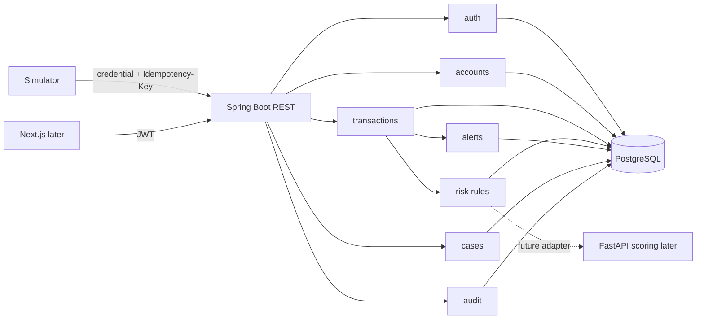

# Architecture

## Decision
Một Spring Boot Modular Monolith, PostgreSQL, module auth/accounts/transactions/risk/alerts/cases/audit. Dễ chạy, debug và giữ transaction nhất quán cho một portfolio MVP. Trade-off: không deploy/scale module độc lập; phải giữ boundary, không truy cập repository module khác.

## Component diagram

## Module boundaries
- `auth`: users, password verification, JWT and role policies.
- `accounts`: account identity/status and lookup contract.
- `transactions`: intake orchestration, idempotency, persistence/response.
- `risk`: deterministic rules, score/reasons, threshold and rule version.
- `alerts`: state machine and optimistic version.
- `cases`: one-to-one alert investigation and resolution.
- `audit`: append-only semantic events and authorized query.
Giao tiếp qua application/domain interfaces; không sửa bảng/repository module khác trực tiếp.

## End-to-end transaction flow
1. Simulator gửi source-authenticated request, key và payload.
2. API validate, canonicalize payload, hash; source lấy từ credential, không tin body.
3. PostgreSQL transaction claim unique `(source,key)`. Concurrent request được unique constraint/locking phân xử.
4. Kiểm tra unique `(source,external_transaction_id)` và account ACTIVE.
5. Chạy rules in-process; tính score/reasons/version.
6. Insert transaction + snapshot, optional alert, audit và completed idempotency response cùng transaction.
7. Commit rồi mới trả response. Lỗi bất kỳ rollback đồng bộ; retry cùng key sau commit replay response.

Không giữ DB transaction trong lúc gọi mạng. Idempotency claim/completion cùng transaction nên request khác không được coi PROCESSING là kết quả hoàn tất.

## Transaction boundaries
- Intake: idempotency result, transaction, risk snapshot, alert nếu có, audit atomic.
- Alert/case update: versioned update và audit atomic.
- Case create: unique alert link + case + audit atomic.
- MVP không có external side effect trong transaction. Nếu sau này có notification, cân nhắc outbox.

## Error handling
`400` malformed/validation; `401` thiếu/sai/hết hạn auth; `403` thiếu role; `404` không tồn tại; `409` idempotency/duplicate/state/version conflict; `500` lỗi không dự kiến, chỉ kèm correlation ID. Stable error code, không stack/SQL/token trong response. Retry transient errors cùng key; không retry 4xx.

## Vì sao không microservices
Microservices khiến transaction–alert–audit consistency thành saga/eventual consistency, thêm mạng, retry, deploy và observability. MVP chưa có scale/ownership độc lập để bù chi phí. Modular Monolith giữ boundary, dễ tách sau nếu có nhu cầu đo được.

## Tích hợp FastAPI sau này
Risk module gọi interface scoring. MVP là implementation in-process; sau này thêm remote adapter với timeout, model/rule version, correlation ID, bounded retry. Chốt rõ fail policy (reject, pending hoặc fallback; không fallback âm thầm). Lưu scoring snapshot atomically. Nếu asynchronous cần thiết, thêm outbox/job mechanism khi có yêu cầu; không mặc định Kafka.

## OPEN QUESTIONS
API key provisioning; threshold changes có hiệu lực tức thì hay versioned; replay trả status gốc hay 200 (đề xuất replay status/body gốc).
