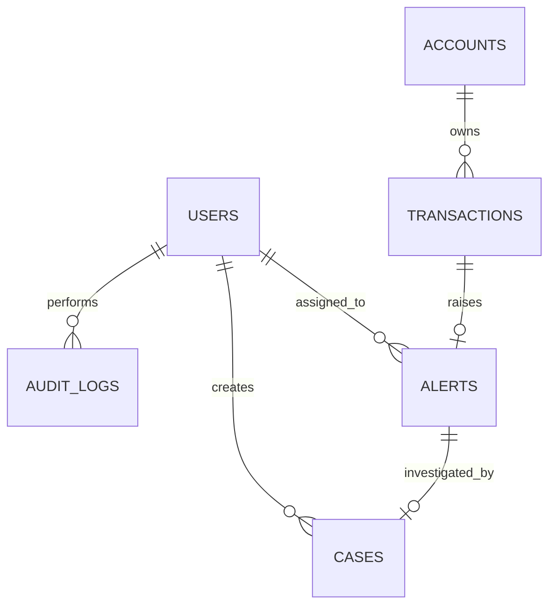

# Database Design

## ERD

## Schema (PostgreSQL)
| Table | Columns and constraints |
|---|---|
| `users` | `id UUID PK`, `username VARCHAR(100) NOT NULL UNIQUE` (normalized), `password_hash VARCHAR(255) NOT NULL`, `role VARCHAR(20) NOT NULL` CHECK ANALYST/ADMIN, `enabled BOOLEAN NOT NULL`, timestamps. Disable instead of delete. |
| `accounts` | `id UUID PK`, `account_ref VARCHAR(100) NOT NULL UNIQUE`, `status VARCHAR(20) NOT NULL` CHECK ACTIVE/SUSPENDED, timestamps. Synthetic reference only. |
| `transactions` | `id UUID PK`, `account_id UUID NOT NULL FK`, `source VARCHAR(80) NOT NULL`, `external_transaction_id VARCHAR(150) NOT NULL`, `amount NUMERIC(19,4) NOT NULL CHECK >0`, `currency CHAR(3) NOT NULL`, `risk_score SMALLINT NOT NULL CHECK 0..100`, `risk_reasons JSONB NOT NULL`, `ruleset_version VARCHAR(50) NOT NULL`, `occurred_at TIMESTAMPTZ NOT NULL`, `created_at TIMESTAMPTZ NOT NULL`; UNIQUE(source, external_transaction_id). |
| `alerts` | `id UUID PK`, `transaction_id UUID NOT NULL UNIQUE FK`, `assigned_to UUID NULL FK users`, `status VARCHAR(24) NOT NULL`, `version INTEGER NOT NULL DEFAULT 0`, timestamps. Unique FK ensures max one alert per transaction. |
| `cases` | `id UUID PK`, `alert_id UUID NOT NULL UNIQUE FK alerts`, `created_by UUID NOT NULL FK users`, `status VARCHAR(24) NOT NULL`, `resolution VARCHAR(50) NULL`, `summary TEXT`, `version INTEGER NOT NULL DEFAULT 0`, timestamps. Unique FK enforces one-to-one. |
| `audit_logs` | `id UUID PK`, `actor_id UUID NULL FK users` (system may be null), `entity_type VARCHAR(30) NOT NULL`, `entity_id UUID NOT NULL`, `action VARCHAR(50) NOT NULL`, `before_data/after_data JSONB`, `correlation_id VARCHAR(100)`, `created_at TIMESTAMPTZ NOT NULL`. Append-only app behavior; no sensitive body. |
| `idempotency_records` | `id UUID PK`, `source VARCHAR(80) NOT NULL`, `idempotency_key VARCHAR(128) NOT NULL`, `request_hash CHAR(64) NOT NULL`, `state VARCHAR(20) NOT NULL`, `transaction_id UUID NULL FK`, `response_status INTEGER NULL`, `response_body JSONB NULL`, timestamps; UNIQUE(source,idempotency_key). |

## Indexes and integrity
- Unique indexes listed above; FK restrictive deletion to preserve history.
- Transactions `(account_id, occurred_at DESC)`; alerts `(status, created_at DESC, id)` and `(assigned_to,status,created_at DESC)` if assignment retained; cases `(status,updated_at DESC)`; audit `(entity_type,entity_id,created_at DESC)`.
- Idempotency cleanup by `created_at` only after retention policy. Stable page ordering includes ID; bound page size.
- Database constraints are final defense against races; application pre-check alone is insufficient.

## Money, source and external identity
Money is `NUMERIC(19,4)` with Java `BigDecimal`; reject >4 decimals rather than silently round. Currency explicit; no FX. Source is authenticated identity (not client-controlled payload); external ID is unique within source. Different sources may reuse external ID.

## Idempotency lifecycle
Scope `(source,key)`. Hash canonical validated payload excluding transport fields. Same hash replays stored status/body; different hash → 409. Claim and completion commit with business rows; rollback removes claim, commit followed by lost HTTP response is replayable. Keep records for a documented retry horizon.

## Optimistic locking
`alerts.version` and `cases.version` increment per update. Require expected version (body or If-Match); stale update → 409. ORM `@Version` is suitable. Audit and update share DB transaction.

## OPEN QUESTIONS
Source registry table vs local config; audit/idempotency retention; whether entity_id needs polymorphic FK (not directly enforceable); account deletion policy (recommend disable only).
